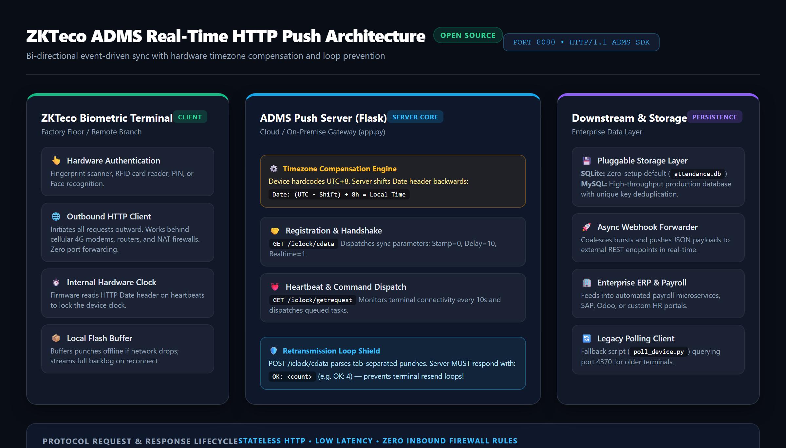

# Solving the Undocumented ZKTeco ADMS Protocol: Hardware Timezones, Infinite Loops, and Python HTTP Push

If you have ever been tasked with integrating physical biometric terminals (like ZKTeco F22, IN01, K40, or uFace) with an enterprise web application or ERP, you likely started where everyone does: **legacy TCP polling over port 4370**.

And like most engineers, you quickly hit a brick wall:
- The device requires a static LAN IP or VPN tunnel at every site.
- It fails when terminals are deployed in remote branch offices behind NAT firewalls or cellular 4G modems.
- Polling in batch intervals means punch logs can take 15 to 60 minutes to appear in your payroll system.

Fortunately, modern ZKTeco firmware includes an outbound cloud sync feature called **ADMS (Automatic Data Master Server)**. Instead of your server reaching into the device, the device opens an outbound HTTP connection and pushes attendance punches in real-time.

However, the protocol is notoriously undocumented. While attempting to implement a production ADMS server, I ran into two critical firmware quirks that cost days of packet-sniffing and debugging.

Here is how the protocol works under the hood, how I resolved the hardcoded firmware bugs, and how you can run a production-ready ADMS push server in Python.

---

## 1. High-Level Architecture: Outbound Push vs. Inbound Polling

In legacy polling, your server acts as the client and dials into port 4370 of each device. In ADMS HTTP Push, the roles are reversed:



### Why HTTP Push Wins:
1. **Zero Inbound Firewall Configuration:** The terminal establishes an outbound HTTP connection (`0.0.0.0:8080`) to your server. No port forwarding or public static IPs are needed on the device side.
2. **Sub-Second Latency:** When an employee scans a fingerprint or RFID card, the punch is POSTed to your server within 1 second.
3. **Resilient Offline Buffering:** If the factory internet connection drops, the terminal stores records in flash memory and streams the entire backlog upon reconnecting.

---

## 2. Engineering Discovery #1: The Factory UTC+8 Timezone Bug

This was the most elusive bug I encountered.

### The Problem
When you configure an ADMS server, the device periodically issues a heartbeat GET request to `/iclock/getrequest`. Standard HTTP (RFC 7231) mandates that the `Date` header in server responses must always be in GMT/UTC.

However, ZKTeco's proprietary firmware parses the HTTP `Date` header and **blindly adds +8 hours** (assuming the server is operating in China Standard Time, UTC+8). 

Even if you manually configure the device's clock or local timezone in its physical settings menu, the next HTTP heartbeat overrides the clock, jumping the device forward or backward into the wrong time. If your company operates in Sri Lanka or India (UTC+5:30), for example, the device will jump by **2.5 hours**.

### The Solution: Compensatory Date Header Shifting
Rather than fighting the terminal's proprietary firmware, we can compensate at the server level by shifting the HTTP `Date` header backwards:

$$\text{Shift} = \text{Device Factory Offset (UTC+8)} - \text{Target Local Offset}$$

For UTC+5:30:
$$\text{Shift} = 8.0 - 5.5 = 2.5\text{ hours (2 hours, 30 minutes)}$$

We implement this in Python Flask using an `@app.after_request` middleware:

```python
from datetime import datetime, timedelta, timezone
from email.utils import formatdate
from flask import Flask, Response, request

app = Flask(__name__)

DEVICE_UTC_OFFSET = 8.0   # Factory hardware default
SERVER_UTC_OFFSET = 5.5   # Target timezone (e.g., UTC+5:30)

@app.after_request
def fix_date_header(response: Response) -> Response:
    """Compensate for the hardcoded UTC+8 firmware bug."""
    shift_hours = DEVICE_UTC_OFFSET - SERVER_UTC_OFFSET
    adjusted_utc = datetime.now(timezone.utc) - timedelta(hours=shift_hours)
    
    # Format according to RFC 7231 GMT specification
    response.headers["Date"] = formatdate(adjusted_utc.timestamp(), usegmt=True)
    return response
```

When the device reads this shifted header and adds its factory +8 hours, it lands on your exact local time down to the second.

---

## 3. Engineering Discovery #2: The Infinite Retransmission Loop

### The Problem
When a device records attendance punches, it sends a `POST` request to `/iclock/cdata?table=ATTLOG` with a tab-delimited payload:

```text
10024	2026-11-09 08:31:14	1	0	0	0
10118	2026-11-09 08:31:22	2	0	0	0
```

Standard HTTP conventions would suggest returning `200 OK` or `{"status": "success"}`. 

If you do this, the device will **never acknowledge the transmission as complete**. It will resend the exact same batch of punches on every single heartbeat interval (every 10 seconds), forever. Over time, the device's network buffer exhausts, leading to packet drops, terminal freeze-ups, and duplicate database rows.

### The Solution: The `OK: <count>` Acknowledgment
The ADMS push firmware specifically looks for a response in the exact format:

```text
OK: <number_of_records_processed>
```

If the payload contained 2 punches, the server must respond with plain text:
```text
OK: 2
```

```python
@app.route("/iclock/cdata", methods=["POST"])
def receive_attendance_data():
    table = request.args.get("table", "").upper()
    if table != "ATTLOG":
        return Response("OK", mimetype="text/plain")

    raw_body = request.data.decode("utf-8", errors="replace")
    records = parse_attlog(raw_body)
    
    # Save to database and deduplicate
    inserted, duplicates = save_punches(records)

    # CRITICAL: Return the count to prevent retransmission loop
    return Response(f"OK: {len(records)}", mimetype="text/plain")
```

Once the terminal receives `OK: 2`, it purges the processed records from its outbound transmission queue and resumes normal operation.

---

## 4. End-to-End Implementation

To help developers avoid these headaches, I have open-sourced a complete, production-ready implementation:

**GitHub Repository:** [https://github.com/Ockersz/zkteco-adms-server](https://github.com/Ockersz/zkteco-adms-server)

### Included Features:
- **Zero-Setup SQLite Default:** Runs out of the box with `python app.py` (optional MySQL support via `.env`).
- **Timezone Middleware:** Fully configurable offsets and per-device overrides.
- **Heartbeat & Handshake Engine:** Implements `/iclock/cdata` and `/iclock/getrequest`.
- **Async Webhook Forwarder:** Automatically pipes incoming punches into ERP, SAP, or payroll APIs in real time.
- **Legacy TCP Polling Fallback:** A standalone script for older non-ADMS terminals (Port 4370).
- **Production Templates:** Includes ready-to-use Linux `systemd` service units and `nginx` reverse proxy configs.

---

## 5. Physical Terminal Setup (In 60 Seconds)

To connect any ZKTeco device to this server:
1. Open the device menu and authenticate as Administrator.
2. Go to **Comm.** > **Cloud Server Setting** (or **ADMS** / **Web Server**).
3. Set **Server Address** to your server IP or domain (e.g. `attendance.yourcompany.com`).
4. Set **Server Port** to `8080`.
5. Set **Enable Domain Name** to `ON` if using a hostname, or `OFF` if using a numeric IP.
6. Save and reboot. A cloud icon will appear in the device header once connected.

---

## Conclusion & Takeaways

Working with proprietary IoT and enterprise hardware often requires reading between the lines of sparse documentation. By understanding the HTTP Date header clock synchronization mechanics and implementing exact acknowledgment counts, you can transform legacy biometric terminals into reliable, modern cloud IoT clients.

Feel free to star or fork the repository on [GitHub](https://github.com/Ockersz/zkteco-adms-server) or connect with me on [LinkedIn](https://www.linkedin.com/in/shahein-ockersz/).

---
*Author: **Shahein Noel Ockersz** — Senior Software Engineer | Systems Architect*  
*Portfolio: [shahein-portfolio.vercel.app](https://shahein-portfolio.vercel.app/)*

